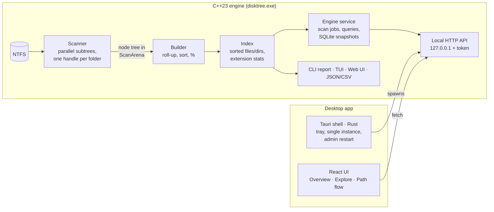

<div align="center">


# DiskTree

**Storage intelligence for Windows: see exactly where your disk space goes.**

A fast, private disk-usage analyzer with a desktop app and a command-line tool, built on a multi-threaded C++23 engine.

[](https://github.com/siddharthpaul2005/DiskTree/actions/workflows/ci.yml)
[](https://github.com/siddharthpaul2005/DiskTree/releases/latest)
[](#requirements)
[](LICENSE)

[**Download**](https://github.com/siddharthpaul2005/DiskTree/releases/latest) ·
[Features](#features) ·
[Understanding the numbers](#understanding-the-numbers) ·
[Command line](#command-line-tool) ·
[Build from source](#building-from-source) ·
[Roadmap](#roadmap)

</div>

<!-- Add a screenshot of the Overview screen as docs/screenshot.png, then uncomment:
<p align="center"></p>
-->

---

## Contents

- [Install](#install)
- [Features](#features)
- [Understanding the numbers](#understanding-the-numbers)
- [Privacy and security](#privacy-and-security)
- [Command-line tool](#command-line-tool)
- [Performance](#performance)
- [Architecture](#architecture)
- [Building from source](#building-from-source)
- [Testing](#testing)
- [Releasing](#releasing)
- [Roadmap](#roadmap)
- [Troubleshooting](#troubleshooting)
- [Contributing](#contributing)
- [License](#license)

## Install

1. Download **`DiskTree-<version>-setup.exe`** from the [latest release](https://github.com/siddharthpaul2005/DiskTree/releases/latest).
2. Run it. DiskTree installs for the current user only, so no administrator rights are needed.
3. Open **DiskTree** from the Start menu and pick a drive.

An **`.msi`** package is on the same page for managed or company PCs.

> [!NOTE]
> The installer is not code-signed yet, so Windows SmartScreen may say *"Windows protected your PC"*. Click **More info**, then **Run anyway**.

### Requirements

| | |
|---|---|
| **OS** | Windows 10 or 11, 64-bit |
| **Runtime** | Microsoft WebView2. It is built into Windows 11 and up-to-date Windows 10; if it's missing, the installer downloads it. |
| **Disk** | About 10 MB |
| **Rights** | None for normal use. An administrator password is only needed for the optional [full scan](#restart-as-administrator). |

DiskTree checks GitHub for newer releases when it starts and shows a notice when one is available.

## Features

### Scan anything

- **A drive**: every ready drive is listed with its used and free space.
- **The whole PC**: scans every fixed drive in one go and shows them together under *This PC*.
- **A folder**: type or paste a path, use **Browse…**, or pick Desktop, Downloads, Documents, Pictures, Videos, Music or your user folder in one click.
- **Optional filter**: skip developer folders (`node_modules`, `.git`).

### See the results three ways

| View | Best for |
|---|---|
| **Overview** | A ranked breakdown of the biggest folders and files, the drive's free space, the largest single files and space by file type |
| **Explore** | A sunburst chart with a synced list. Hover a row to light up its slice; click to step into a folder |
| **Path flow** | An icicle chart that reads left to right, so you can follow the biggest folders down to the files |

Every item has **Show in File Explorer**. **Search** finds files and folders by name across the whole scan.

### Space left, and where the rest went

The **Drive space** card on the Overview splits the drive into three parts: *files found*, *space Windows keeps hidden* and *free*. Free space is also always visible in the sidebar. See [Understanding the numbers](#understanding-the-numbers).

### Snapshots

Save a scan as a snapshot, then compare a later scan with it to see which folders and files were added, removed, grew or shrank. Snapshots are shared with the command-line tool.

### Restart as administrator

Windows keeps some folders closed to normal programs, including `C:\Windows\Temp`, other users' profiles and restore points. When a scan finds such folders, DiskTree offers **Restart as administrator**. Windows asks for permission, DiskTree restarts with administrator rights and scans the same drive again, now including those folders. Even then DiskTree only reads names and sizes.

## Understanding the numbers

Disk tools often disagree with each other and with File Explorer. DiskTree shows why.

| Term | Meaning |
|---|---|
| **Size** (in lists) | The file's length, the same number File Explorer shows. |
| **Files found** | What the scanned files really occupy *on disk*. A file stored under two names (a *hard link*, which Windows uses heavily in `C:\Windows`) is counted once, compressed files count their compressed size, and small files are rounded up to whole disk clusters. |
| **Hidden by Windows** | Space the drive reports as used that no listing can show: restore points, the drive's own file table (which also stores very small files), folders only administrators can open and other accounts' Recycle Bins. |
| **Free** | Space available for new files. |

*Files found + Hidden by Windows + Free = the drive's capacity*, so the numbers always add up.

> [!TIP]
> If the list of folders adds up to *more* than the drive uses, that's hard links: on a typical PC about 10 GB of `C:\Windows` is listed twice by File Explorer but stored only once. DiskTree says so under the Drive space card.

With administrator rights, DiskTree also measures the drive's file table directly and shows it separately, so the hidden remainder shrinks to Windows' own bookkeeping.

## Privacy and security

- **Read-only.** DiskTree reads file names, sizes and dates. It never moves, changes, deletes or opens your files' contents, including in administrator mode.
- **Offline.** No telemetry, no accounts. The only network request is the update check, which reads the public [GitHub releases](https://github.com/siddharthpaul2005/DiskTree/releases) list.
- **Local only.** The scanning engine runs as a background process that listens on `127.0.0.1` on a random port, rejects requests without a random per-launch token, refuses browser pages from other origins, and exits when the app closes.
- **Your data stays put.** Snapshots are kept in `%LOCALAPPDATA%\DiskTree\disktree.db` (SQLite) on your PC.

Found a security issue? Please report it privately through [GitHub security advisories](https://github.com/siddharthpaul2005/DiskTree/security/advisories/new) rather than a public issue.

## Command-line tool

The same engine ships as a standalone, single-file `disktree.exe` with a text report, an interactive terminal UI and a browser UI. Download **`disktree-windows-x64.exe`** from the [releases page](https://github.com/siddharthpaul2005/DiskTree/releases/latest). It needs no installer and no extra DLLs.

### Quick start

```powershell
disktree .                                     # scan the current folder
disktree D:\                                   # scan a drive
disktree D:\ --tui                             # interactive terminal UI
disktree D:\ --web                             # browser UI with a treemap
disktree D:\ --export json --output scan.json  # export to JSON (or csv)
disktree D:\ --ext mp4 --sort modified         # only .mp4 files, newest first
disktree D:\ --top 50 --depth 5 --min-size 1MB # top 50, deeper tree, skip files < 1 MB
disktree D:\ -x build -x "*.tmp"               # skip more names (wildcards allowed)
disktree D:\ --snapshot                        # save a snapshot...
disktree D:\ --diff latest                     # ...and later see what changed
```

> [!NOTE]
> The command-line tool skips `$RECYCLE.BIN`, `System Volume Information`, `.git` and `node_modules` by default. Add more with `-x NAME`, or scan everything with `--no-default-excludes`. To include admin-only folders, run it from an administrator terminal.

### Options

```text
disktree [OPTIONS] [path]

  path                    Directory to scan (default: current directory)
  -d, --depth INT         Tree display depth, 0 = unlimited (default: 3)
  -n, --top INT           Number of top files/dirs to show (default: 20)
  -s, --sort TEXT         size|name|count|modified (default: size)
  --min-size TEXT         Skip files smaller than this, e.g. 1MB, 500KB, 1.5G
  --ext TEXT              Only list files with this extension, e.g. .mp4 or mp4
  -x, --exclude TEXT      Skip files/dirs with this name; * and ? allowed. Repeatable
  --no-default-excludes   Also scan $RECYCLE.BIN, System Volume Information, .git, node_modules
  -j, --threads INT       Scanner threads, 0 = all CPU cores (default: 0)
  --export TEXT           Export format: json|csv
  -o, --output TEXT       Export file path (default: disktree_export.<fmt>)
  --no-tree               Skip the tree view
  --snapshot              Save the scan as a snapshot for later --diff
  --diff TEXT             Compare with a snapshot: its id, "latest" (newest of this path),
                          or a .json.zst file
  --list-snapshots        List saved snapshots and exit
  --tui                   Launch the interactive terminal UI
  --web                   Launch the web UI in your browser
  --port INT              Web UI port; the next free port is used if busy (default: 7821)
  --no-browser            With --web, don't open the browser automatically
  --version               Show version
  -h, --help              Show help
```

- **`--sort`** orders the tree and the top lists. `count` ranks folders by number of files, `modified` shows the most recently changed first, and `name` keeps the N largest and lists them alphabetically.
- **Tree view** works like `tree -L`: each folder lists at most its 15 largest subfolders and 10 largest files, and the rest are summarised as `... N more`.
- **Colours** turn off automatically when output is redirected (`disktree D:\ > report.txt`) or when `NO_COLOR` is set.

### Snapshots and diff

```powershell
disktree D:\ --snapshot     # save a snapshot of D:\
disktree D:\ --diff latest  # compare a fresh scan with the newest snapshot of D:\
disktree D:\ --diff 3       # ...or with snapshot #3
disktree --list-snapshots   # ids, dates and sizes
```

A snapshot stores every file's relative path, size and modified time, compressed with zstd. A scan of 230,000 files takes a few MB. The diff report shows the net change, the biggest changes per top-level folder, then the added, removed, grown and shrunk files. Snapshots saved by version 0.1 can't be compared; take a new one.

### Terminal UI keys

| Key | Action |
|---|---|
| `↑` `↓` / `k` `j` | Move |
| `PgUp` `PgDn` | Scroll fast |
| `Home` `End` | First / last |
| `Enter` | Open folder |
| `Backspace` | Go up |
| `/` | Filter |
| `Esc` | Clear filter |
| `q` | Quit |

### Web UI

`--web` serves `http://127.0.0.1:7821`, reachable only from your own PC, and opens it in your browser. Click a rectangle to drill in, press `Backspace` or `Esc` to go up, and hover for details. D3 is embedded in the executable, so it works offline. Press `Ctrl+C` to stop.

## Performance

**Machine:** AMD Ryzen 5 5600H (6 cores, 12 threads), 16 GB RAM, NVMe SSD, Windows 11, NTFS.
**Dataset:** `D:\` with 348,177 files (52.4 GB) after the default exclusions.
**Method:** `disktree_bench`, median of 3 runs of scan + build + index, warm cache.

| Threads | Median | Files per second |
|---:|---:|---:|
| 1 | 3.78 s | ~92,000 |
| 4 | 1.56 s | ~223,000 |
| 12 | **1.04 s** | **~335,000** |

A full scan of both drives on the same machine (1.2 million files, 233 GB) takes about 8 seconds with a warm cache. Reproduce with:

```powershell
.\build\release\benchmarks\disktree_bench.exe D:\ 3 1 4 12   # path, runs, thread counts...
```

## Architecture



| Component | Responsibility | Source |
|---|---|---|
| **Scanner** | Walks the file system on a thread pool. On Windows each folder is listed through a single handle (`GetFileInformationByHandleEx`), which returns every entry's size, on-disk allocation and file ID without opening the files. File IDs are used to count hard links once. | `src/core/scanner.cpp` |
| **Builder** | Rolls sizes and counts up the tree, sorts children by size and computes each node's share of its parent. | `src/core/builder.cpp` |
| **Index** | Flat, pre-sorted lists of files and folders plus extension statistics, so a top-N query is a slice. | `src/core/index.cpp` |
| **Snapshots** | Flattens a scan into `path → size, mtime`, stores it zstd-compressed in SQLite and diffs two of them. | `src/core/snapshot*.cpp` |
| **Platform** | Drives and free space, known folders, administrator detection and the NTFS file-table size. | `src/platform/drives.cpp` |
| **Engine service** | Runs scans in the background (one drive, the whole PC or a folder), answers queries and owns the snapshot store. | `src/service/engine.cpp` |
| **API server** | `disktree serve`: the token-protected local HTTP API the app talks to. Stops when its parent process exits. | `src/service/api_server.cpp` |
| **Desktop shell** | Starts the engine, passes the port and token to the UI, and provides the tray icon, single-instance handling and *Restart as administrator*. | `app/src-tauri/src/lib.rs` |
| **UI** | React 19 + TypeScript, charts drawn with `d3-hierarchy` and `d3-shape`. | `app/src/` |

<details>
<summary><b>Local API reference</b></summary>

All requests need the `X-DiskTree-Token` header. Responses are JSON.

| Method | Path | Purpose |
|---|---|---|
| `GET` | `/api/health` | Version, database path, administrator status |
| `GET` | `/api/drives` | Drives with size and free space |
| `GET` | `/api/places` | Known user folders |
| `POST` | `/api/scan` | Start a scan: `{ path, whole_pc, excludes, default_excludes, threads }` |
| `POST` | `/api/scan/cancel` | Cancel the running scan |
| `GET` | `/api/scan/status` | Progress, and the result summary with drive space |
| `GET` | `/api/node` | A folder and its children: `path`, `depth`, `max_children`, `min_fraction` |
| `GET` | `/api/top-files`, `/api/top-dirs`, `/api/extensions` | Largest items and file types: `n` |
| `GET` | `/api/search` | Files and folders by name: `q`, `limit` |
| `GET` `POST` `DELETE` | `/api/snapshots`, `/api/snapshots/{id}` | List, save, delete snapshots |
| `GET` | `/api/diff` | Compare the current scan with a snapshot: `snapshot`, `limit` |
| `POST` | `/api/reveal` | Show a path in File Explorer |
| `POST` | `/api/shutdown` | Stop the engine |

</details>

<details>
<summary><b>Design decisions</b></summary>

**Arena allocation.** A large scan creates hundreds of thousands of nodes. `ScanArena` bump-allocates `FileNode` and `DirNode` objects in 4 MB slabs instead of one heap allocation each, and interns file extensions so a few hundred strings are shared by every file. The arena belongs to the `ScanResult` and is freed slab by slab.

**Iterative traversal.** Folder trees can be very deep (`node_modules`, long Windows paths), so neither the scanner nor the builder recurses per level. Both use explicit stacks and cannot overflow the call stack.

**Threading.** Each folder down to three levels below the root becomes its own thread-pool task; deeper folders are walked by that task. A node is only modified by the task that created it, so the tree needs no locks. Ties are broken by name, so a parallel scan produces exactly the same result as a single-threaded one.

**Honest totals.** Explorer-style sizes are kept for every file and folder, while on-disk allocation is summed separately with hard links counted once. The difference between the drive's used space and that sum is reported as *hidden* instead of silently disappearing.

**A separate engine process.** The UI never touches the file system. Keeping the engine in its own process means a long scan can't freeze the window, the same binary serves the CLI and the app, and the API is the single contract between them.

</details>

### Repository layout

```text
DiskTree/
├── app/                     Desktop app
│   ├── src/                 React UI (views, components, API client)
│   ├── src-tauri/           Rust shell, installer settings, icons
│   ├── e2e/                 Playwright end-to-end tests
│   └── scripts/             prepare-sidecar.mjs (copies the engine into the bundle)
├── include/disktree/        Engine headers
│   ├── core/                Scanner, Builder, Index, ScanArena, snapshots, models
│   ├── service/             Engine service and local API server
│   ├── platform/            Drives, known folders, administrator access
│   ├── interfaces/          Terminal UI (FTXUI) and web UI (cpp-httplib)
│   ├── export/              JSON and CSV
│   └── utils/               Thread pool, progress, formatting
├── src/                     Engine sources (same layout)
├── tests/                   Catch2 unit tests
├── benchmarks/              disktree_bench
├── scripts/build.ps1        One-command engine build
├── packaging/scoop/         Scoop manifest
├── third_party/d3/          D3, embedded into the CLI web UI
└── .github/workflows/       CI and release pipelines
```

## Building from source

### Prerequisites

| Tool | Install |
|---|---|
| Git | `winget install --id Git.Git -e` |
| Visual Studio 2022 Build Tools (C++ workload: MSVC with C++23, CMake 3.28+, Ninja) | `winget install --id Microsoft.VisualStudio.2022.BuildTools -e --override "--passive --wait --add Microsoft.VisualStudio.Workload.VCTools --includeRecommended"` |
| Node.js 22+ *(app only)* | `winget install OpenJS.NodeJS.LTS` |
| Rust *(app only)* | `winget install Rustlang.Rustup` |

Open a **new** PowerShell window after installing so the tools are on your `PATH`.

### Engine and command-line tool

```powershell
git clone https://github.com/siddharthpaul2005/DiskTree.git
cd DiskTree
powershell -ExecutionPolicy Bypass -File scripts\build.ps1 -Test
```

`build.ps1` finds the compiler, sets up [vcpkg](https://github.com/microsoft/vcpkg) in `%USERPROFILE%\vcpkg` if `VCPKG_ROOT` isn't set, builds the dependencies and the engine, and runs the tests. **The first run takes 10–20 minutes** while it compiles the libraries; later runs take seconds. The result is `build\release\disktree.exe`, a single static executable.

<details>
<summary>Manual build with CMake presets</summary>

From an *x64 Native Tools Command Prompt for VS 2022*, with `VCPKG_ROOT` set:

```powershell
cmake --preset release-static      # or: dev (debug)
cmake --build --preset release-static
ctest --preset release-static
```

</details>

### Desktop app

Build the engine first, then:

```powershell
cd app
npm ci                 # UI dependencies
npm run sidecar        # copy the engine next to the app
npx tauri build        # app + installers
```

The installers are written to `app\src-tauri\target\release\bundle\nsis\` (`.exe`) and `...\bundle\msi\` (`.msi`). For development with hot reload, run `npx tauri dev`.

### Dependencies

| Engine (via vcpkg) | Desktop app |
|---|---|
| [CLI11](https://github.com/CLIUtils/CLI11): arguments | [Tauri 2](https://tauri.app): native shell |
| [fmt](https://github.com/fmtlib/fmt): formatting | [React 19](https://react.dev): UI |
| [FTXUI](https://github.com/ArthurSonzogni/FTXUI): terminal UI | [d3-hierarchy, d3-shape](https://d3js.org): charts |
| [cpp-httplib](https://github.com/yhirose/cpp-httplib): HTTP server | [Vite](https://vite.dev): bundler |
| [nlohmann/json](https://github.com/nlohmann/json): JSON | [Vitest](https://vitest.dev), [Playwright](https://playwright.dev): tests |
| [SQLite](https://sqlite.org): snapshot store | |
| [zstd](https://github.com/facebook/zstd): compression | |
| [Catch2](https://github.com/catchorg/Catch2): tests | |

## Testing

| Suite | Command | Covers |
|---|---|---|
| Engine unit tests (Catch2) | `powershell -ExecutionPolicy Bypass -File scripts\build.ps1 -Test` | Scanning, hard links, roll-up, index, snapshots and diff, export, the engine service and API |
| UI unit tests (Vitest) | `cd app; npm test` | Formatting, colours, API client, chart layout |
| End-to-end (Playwright) | `cd app; npx playwright test` | A real engine and the real UI in Microsoft Edge: scans a generated folder with known sizes and goes through every view |

Every push and pull request to `main` runs all three on GitHub Actions ([`ci.yml`](.github/workflows/ci.yml)).

## Releasing

Releases are built by GitHub Actions ([`release.yml`](.github/workflows/release.yml)) whenever a tag starting with `v` is pushed.

1. Set the new version in `app/src-tauri/tauri.conf.json`, `app/src-tauri/Cargo.toml`, `app/package.json`, `CMakeLists.txt` and `vcpkg.json`.
2. Commit and merge to `main`.
3. Tag and push:
   ```powershell
   git tag v1.2.0
   git push origin v1.2.0
   ```

The workflow builds and tests everything, then publishes a GitHub release with the setup `.exe`, the `.msi` and the standalone `disktree-windows-x64.exe`. Installed copies of DiskTree pick up the new release through their update check.

## Roadmap

| Phase | Focus | Status |
|---|---|---|
| **1** | Desktop app: drive, whole-PC and folder scans, three views, search, snapshots, drive space, administrator mode, installers | ✅ v1.1 |
| **2** | Cleanup advisor: find caches, duplicates, old downloads and leftovers, with safe, reviewable suggestions | Planned |
| **3** | Knowledge graph and AI assistant: ask questions about your storage in plain language | Planned |
| **4** | Instant scans from the NTFS master file table and USN journal, a desktop widget, Microsoft Store | Planned |

Linux and macOS are not supported yet: the build presets and parts of the engine are Windows-specific.

## Troubleshooting

| Problem | Fix |
|---|---|
| *"Windows protected your PC"* when installing | The installer isn't signed yet. Click **More info**, then **Run anyway**. |
| App shows *"The engine could not start"* | Reinstall. If your antivirus quarantined `disktree-engine.exe`, restore and allow it. |
| App window is blank | Install or repair the [WebView2 runtime](https://developer.microsoft.com/microsoft-edge/webview2/). |
| *Not readable* shows many folders | These are admin-only Windows folders. Use **Restart as administrator** on the Overview. |
| Totals differ from File Explorer | See [Understanding the numbers](#understanding-the-numbers). |
| `build.ps1 cannot be loaded because running scripts is disabled` | Run it as `powershell -ExecutionPolicy Bypass -File scripts\build.ps1`. |
| `MSVC C++ build tools not found` | Install the Build Tools from [Prerequisites](#prerequisites), then open a new PowerShell window. |
| The first build seems stuck | It's compiling the dependencies: 10–20 minutes once, cached afterwards. |
| CLI web UI says the port is busy | DiskTree picks the next free port automatically; use the URL it prints, or pass `--port 9000`. |
| Box-drawing characters look garbled in the terminal | Use Windows Terminal, or a font such as Cascadia Mono or Consolas. |

## Contributing

Issues and pull requests are welcome.

1. Fork the repository and create a branch from `main`.
2. Make your change, and add or update tests for it.
3. Run the three test suites from [Testing](#testing).
4. Open a pull request describing what changed and why.

Please keep DiskTree read-only: nothing in the engine may modify the files it scans.

## License

[MIT](LICENSE) © 2026 Siddharth Paul. D3 is ISC-licensed; see [`third_party/d3/LICENSE`](third_party/d3/LICENSE).
