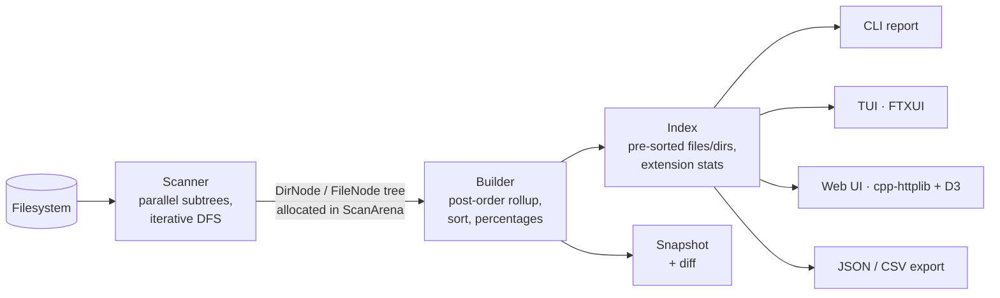

# 🌳 disktree

A fast disk usage analyzer for Windows, written in C++23.

It scans a drive and shows what's using the space. There are three ways to view the results: a CLI report, an interactive TUI and a web UI with a treemap. It can also save snapshots and show what changed between two scans.

<!-- TODO: record a demo GIF (e.g. with ScreenToGif) showing a scan followed by --tui and --web, save it as assets/demo.gif, then uncomment:

-->

## Features

- **Fast, multi-threaded scan**: about 337,000 files (39 GB) in 1.7 seconds on 12 threads. See [Benchmarks](#benchmarks).
- **Three interfaces**: CLI report, interactive TUI ([FTXUI](https://github.com/ArthurSonzogni/FTXUI)) and a browser UI with a D3 treemap
- **Snapshots and diff**: save a scan, then later see which files and folders were added, removed, grew or shrank
- **Extension breakdown**: shows which file types take up the most space
- **Filters**: by extension, minimum size and name patterns (`-x "*.log"`)
- **Export**: JSON and CSV output for further analysis
- **Works offline**: the web UI's D3 library is built into the executable
- **Single static binary**: links the MSVC runtime statically, so there's no installer and no DLLs to ship

## Platform support

| Platform | Status |
|----------|--------|
| Windows 10/11 x64 | ✅ Built and tested in CI (`windows-2022`), released as `disktree-windows-x64.exe` |
| Linux / macOS | ❌ Not supported yet. The build presets target `x64-windows`. |

## Running it on a new PC

Pick **one** of these.

### Option A: download the ready-made .exe (no build tools needed)

If a release has been published on the [Releases page](https://github.com/siddharthpaul2005/DiskTree/releases), download `disktree-windows-x64.exe`, put it in a folder, open PowerShell in that folder and run:

```powershell
.\disktree-windows-x64.exe C:\Users --top 10
```

### Option B: build from source (one script)

You need **Git** and the **Visual Studio 2022 Build Tools** with the C++ workload. Skip any step you already have.

```powershell
# 1. Git (skip if `git --version` works)
winget install --id Git.Git -e

# 2. C++ build tools: MSVC, CMake and Ninja (~3 GB, one time)
winget install --id Microsoft.VisualStudio.2022.BuildTools -e --override "--passive --wait --add Microsoft.VisualStudio.Workload.VCTools --includeRecommended"
```

Close PowerShell and open a **new** window so the new tools are on your PATH. Then:

```powershell
git clone https://github.com/siddharthpaul2005/DiskTree.git
cd DiskTree
powershell -ExecutionPolicy Bypass -File scripts\build.ps1 -Test
```

`scripts\build.ps1` finds the compiler, downloads and bootstraps [vcpkg](https://github.com/microsoft/vcpkg) into `%USERPROFILE%\vcpkg` if you don't already have one (`VCPKG_ROOT`), builds the dependencies, builds disktree and runs the tests. **The first run takes 10–20 minutes** because it compiles the libraries. Later runs take seconds.

When it prints `Build OK`, the program is at `build\release\disktree.exe`:

```powershell
.\build\release\disktree.exe . --top 10
.\build\release\disktree.exe C:\Users --web
```

## Quick Start

```powershell
# Scan current directory
disktree .

# Scan a drive
disktree D:\

# Interactive TUI
disktree D:\ --tui

# Web UI (opens your browser)
disktree D:\ --web

# Export to JSON or CSV
disktree D:\ --export json --output scan.json
disktree D:\ --export csv  --output scan.csv

# Only .mp4 files, newest first
disktree D:\ --ext mp4 --sort modified

# Top 50 largest files/dirs, tree depth 5, skip files under 1 MB
disktree D:\ --top 50 --depth 5 --min-size 1MB

# Skip extra folders by name (wildcards allowed)
disktree D:\ -x build -x "*.tmp"

# Save a snapshot today, see what changed later
disktree D:\ --snapshot
disktree D:\ --diff latest
```

> **Default exclusions:** `$RECYCLE.BIN`, `System Volume Information`, `.git` and `node_modules` are skipped. Add more with `-x NAME`, or scan everything with `--no-default-excludes`.

## CLI Reference

```text
disktree [OPTIONS] [path]

  path                    Directory to scan (default: current directory)
  -d, --depth INT         Tree display depth, 0 = unlimited (default: 3)
  -n, --top INT           Number of top files/dirs to show (default: 20)
  -s, --sort TEXT         size|name|count|modified (default: size)
  --min-size TEXT         Skip files smaller than this, e.g. 1MB, 500KB, 1.5G
  --ext TEXT              Only list files with this extension, e.g. .mp4 or mp4
  -x, --exclude TEXT      Skip files/dirs with this name; * and ? allowed. Repeatable
  --no-default-excludes   Also scan $RECYCLE.BIN, System Volume Information, .git, node_modules
  -j, --threads INT       Scanner threads, 0 = all CPU cores (default: 0)
  --export TEXT           Export format: json|csv
  -o, --output TEXT       Export file path (default: disktree_export.<fmt>)
  --no-tree               Skip tree view
  --snapshot              Save scan to ~/.disktree/snapshots/<timestamp>.json.zst
  --diff TEXT             Compare with a snapshot file, or "latest" for the newest
                          snapshot of the same path
  --list-snapshots        List saved snapshots and exit
  --tui                   Launch interactive TUI
  --web                   Launch web UI in browser
  --port INT              Web UI port; the next free port is used if busy (default: 7821)
  --no-browser            With --web, don't open the browser automatically
  --version               Show version
  -h, --help              Show help
```

**How `--sort` works:** it orders the tree and the top lists. `count` ranks directories by number of files, and `modified` shows the most recently changed entries first. `name` keeps the N largest entries and lists them alphabetically.

**Tree view:** shows everything down to `--depth` levels, like `tree -L`. Each folder lists at most its 15 largest subfolders and 10 largest files, and the rest are summarised as `... N more`.

Colours are switched off automatically when output is redirected (`disktree D:\ > report.txt`), or when `NO_COLOR` is set.

## Snapshots and diff

```powershell
disktree D:\ --snapshot          # saves ~/.disktree/snapshots/20261120_101500.json.zst
# ... later ...
disktree D:\ --diff latest       # compares a fresh scan with the newest snapshot of D:\
disktree D:\ --diff 20261120_101500.json.zst
disktree --list-snapshots
```

The diff report shows the net change, then the biggest changes per top-level folder, then the added, removed, grown and shrunk files. A snapshot stores every file's relative path, size and modified time, compressed with zstd. A scan of 230k files takes a few MB.

Snapshots made by disktree 0.1 only held part of the file list, so they can't be diffed. Take a new one.

## TUI Controls

| Key | Action |
|-----|--------|
| `↑` `↓` / `k` `j` | Navigate |
| `PgUp` `PgDn` | Scroll fast |
| `Home` `End` | Jump to first / last |
| `Enter` | Drill into directory |
| `Backspace` | Go up |
| `/` | Filter |
| `Esc` | Clear filter |
| `q` | Quit |

## Web UI

Run with `--web`. It serves `http://127.0.0.1:7821` (only reachable from your own PC) and opens it in your default browser. If port 7821 is busy, it uses the next free one and prints the URL.

- Click a rectangle to drill into that directory
- `Backspace` or `Esc` to go up
- Hover for size and percentage details
- The sidebar shows the extension breakdown

D3 is embedded in the executable, so no internet connection is needed. Press `Ctrl+C` in the terminal to stop the server.

JSON endpoints: `/api/scan`, `/api/node?path=...`, `/api/top-files?n=50`, `/ping`.

## Architecture



| Stage | What it does | Source |
|-------|--------------|--------|
| **Scanner** | Walks the filesystem on a thread pool and allocates a `DirNode`/`FileNode` per entry. Skips permission-denied dirs and records them as errors. | `src/core/scanner.cpp` |
| **Builder** | Rolls up size, file and dir counts and per-extension totals bottom-up. Then it sorts children by size and computes each node's % of its parent. | `src/core/builder.cpp` |
| **Index** | Makes one BFS pass to build flat vectors of files and dirs, both sorted by size, plus extension stats and a by-extension lookup. A top-N query is just a `std::span` slice of a pre-sorted vector. | `src/core/index.cpp` |
| **Snapshot / Diff** | Flattens a scan into `relative path → size, mtime`, saves it as zstd-compressed JSON, and compares two of them. | `src/core/snapshot.cpp` |
| **Interfaces** | The CLI renderer (`main.cpp`), TUI, web server and exporters only read from the `ScanResult` and `Index`. | `src/interfaces/`, `src/export/` |

```text
disktree/
├── include/disktree/
│   ├── core/        # Scanner, Builder, Index, ScanArena, Snapshot, models
│   ├── export/      # JSON, CSV
│   ├── interfaces/  # TUI (ftxui), Web (cpp-httplib)
│   └── utils/       # ThreadPool, Progress, Humanize
├── src/             # Implementations
├── tests/           # Catch2 unit tests
├── benchmarks/      # disktree_bench
├── scripts/         # build.ps1 (one-command build)
├── third_party/     # d3.min.js (embedded into the web UI)
└── packaging/       # Scoop manifest
```

## Design decisions

### Arena allocation for nodes

A large scan creates hundreds of thousands of nodes. If each one got its own `new`, that would mean hundreds of thousands of separate heap allocations. Instead, `ScanArena` (`src/core/arena.cpp`) allocates **4 MB slabs** and bump-allocates `FileNode`/`DirNode` objects into them with placement new. It is owned by `ScanResult`. When the result is destroyed, the arena runs each node's destructor and then frees the memory slab by slab. It also **interns file extensions**, so a few hundred unique `std::string_view`s are shared across every file instead of storing `".cpp"` once per file. Allocation takes a mutex because several scanner threads share one arena.

*Limitation:* only the node structs themselves live in the slabs. Each node's `path` string and child `std::vector`s still allocate on the normal heap.

### Iterative DFS instead of recursion

Directory trees can be very deep (`node_modules`, build outputs, long Windows paths). If the walk recursed once per directory level, a deep enough tree could overflow the call stack. So the scanner uses an explicit `std::stack` of `{path, node, depth}` frames. The Builder's size rollup is also iterative: a post-order traversal on an explicit stack (each node is visited twice, children first). Sorting and percentage passes are iterative BFS.

### Threading

The scan runs on a `utils::ThreadPool` with one worker per CPU core by default (`-j` to change). Each directory down to `PARALLEL_DEPTH_LIMIT` (3) levels below the root becomes its own pool task, and anything deeper is walked by that task with the iterative DFS above. A `DirNode` is only modified by the task that created it, so the tree needs no locks. Only the arena, the error list and the progress path are shared, and they are locked. Counters are `std::atomic`. Sorting ties are broken by name, so a parallel scan prints exactly the same report as `-j 1`.

A separate `ProgressReporter` thread redraws the live `N files  X GB  current\path` line, so worker threads never print.

## Benchmarks

**Machine:** AMD Ryzen 5 5600H (6C/12T), 16 GB RAM, 512 GB NVMe SSD (Micron MTFDKBA512QFM), Windows 11, NTFS
**Dataset:** `D:\` with 336,868 files, 39.07 GB (after default exclusions)
**Build:** `release-static` preset. Median of 3 runs of scan + build + index, warm cache.

| Tool | Threads | Cache | Time |
|------|---------|-------|------|
| disktree 1.0.0 | 1 | warm | 5.55 s |
| disktree 1.0.0 | 4 | warm | 2.76 s |
| disktree 1.0.0 | 12 | warm | 1.67 s |
| WinDirStat | — | warm | _TBD_ |

Reproduce with the benchmark tool, which is built next to `disktree.exe`:

```powershell
.\build\release\benchmarks\disktree_bench.exe D:\ 3 1 4 12   # path, runs, thread counts...
```

Note: disktree skips `.git` and `node_modules` by default, so it can read fewer files than the tools it's compared against.

## Building from Source (manual)

`scripts\build.ps1` does all of this for you. To do it by hand you need:

- Windows 10/11 x64
- Visual Studio 2022 or its Build Tools with "Desktop development with C++" (MSVC with C++23, CMake 3.28+, Ninja)
- [vcpkg](https://github.com/microsoft/vcpkg) with `VCPKG_ROOT` set

Run these in a **"x64 Native Tools Command Prompt for VS 2022"** (or after `vcvars64.bat`):

```powershell
# Release (static, single .exe → build\release\disktree.exe) + tests
cmake --preset release-static
cmake --build --preset release-static
ctest --preset release-static

# Debug build + tests
cmake --preset dev
cmake --build --preset dev
ctest --preset dev
```

**Dependencies** (managed by vcpkg, see `vcpkg.json`):
- [CLI11](https://github.com/CLIUtils/CLI11): argument parsing
- [fmt](https://github.com/fmtlib/fmt): formatting
- [FTXUI](https://github.com/ArthurSonzogni/FTXUI): TUI
- [cpp-httplib](https://github.com/yhirose/cpp-httplib): HTTP server
- [nlohmann/json](https://github.com/nlohmann/json): JSON
- [zstd](https://github.com/facebook/zstd): snapshot compression
- [Catch2](https://github.com/catchorg/Catch2): testing
- [D3](https://d3js.org) 7.8.5 (vendored in `third_party/d3`, ISC license): treemap

## Troubleshooting

| Problem | Fix |
|---------|-----|
| `build.ps1 cannot be loaded because running scripts is disabled` | Run it as `powershell -ExecutionPolicy Bypass -File scripts\build.ps1` |
| `MSVC C++ build tools not found` | Install the Build Tools (Option B, step 2), then open a new PowerShell window |
| `git not found` | `winget install --id Git.Git -e`, then open a new PowerShell window |
| First build seems stuck | It's compiling the dependencies. That takes 10–20 minutes once and is cached afterwards |
| Web UI says the port is busy | disktree picks the next free port automatically. Use the URL it prints, or pass `--port 9000` |
| Some folders show `(no access)` | Windows denied access (system folders). Run PowerShell as Administrator to include them |
| Box-drawing characters look garbled | Use Windows Terminal, or a font that has those characters (Cascadia Mono, Consolas) |

## License

MIT, see [LICENSE](LICENSE). D3 is ISC-licensed, see `third_party/d3/LICENSE`.
