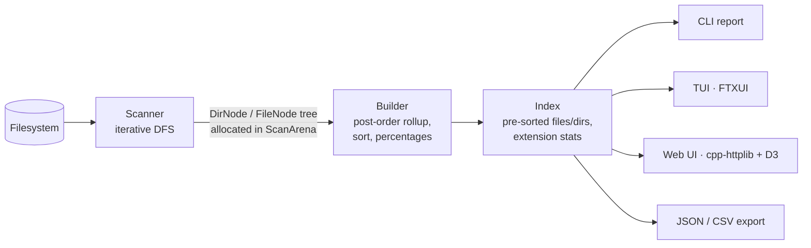

# 🌳 disktree

A fast disk usage analyzer for Windows, written in C++23.

It scans a drive and shows what's using the space. There are three ways to view the results: a CLI report, an interactive TUI and a web UI with a treemap.

<!-- TODO: record a demo GIF (e.g. with ScreenToGif) showing a scan followed by --tui and --web, save it as assets/demo.gif, then uncomment:

-->

## Features

- **Fast**: scans about 230,000 files (210 GB) in about 10 seconds. See [Benchmarks](#benchmarks).
- **Three interfaces**: CLI report, interactive TUI ([FTXUI](https://github.com/ArthurSonzogni/FTXUI)) and a browser UI with a D3 treemap
- **Extension breakdown**: shows which file types take up the most space
- **Export**: JSON and CSV output for further analysis
- **Snapshots**: saves a scan to `~/.disktree/snapshots/` (diffing snapshots is not implemented yet)
- **Single static binary**: links the MSVC runtime statically, so there's no installer and no DLLs to ship

## Platform support

| Platform | Status |
|----------|--------|
| Windows 10/11 x64 | ✅ Built and tested in CI (`windows-2022`), released as `disktree-windows-x64.exe` |
| Linux / macOS | ❌ Not supported yet. The build presets target `x64-windows` and the web UI launches the browser with `ShellExecuteA`. |

## Quick Start

```powershell
# Scan current directory
disktree .

# Scan a drive
disktree D:\

# Launch interactive TUI
disktree D:\ --tui

# Launch web UI (opens browser automatically)
disktree D:\ --web

# Export to JSON
disktree D:\ --export json --output scan.json

# Show only .mp4 files
disktree D:\ --ext .mp4

# Top 50 largest files/dirs, tree depth 5
disktree D:\ --top 50 --depth 5
```

> **Default exclusions:** `$RECYCLE.BIN`, `System Volume Information`, `.git` and `node_modules` are skipped. You can't configure this from the command line yet.

## CLI Reference

```text
disktree [OPTIONS] [path]

  path                  Directory to scan (default: current directory)
  -d, --depth INT       Tree display depth, 0 = unlimited (default: 3)
  -n, --top INT         Number of top files/dirs to show (default: 20)
  -s, --sort TEXT       size|name|count|modified (default: size). Parsed but not
                        applied yet; output is always sorted by size
  --min-size TEXT       Skip files smaller than this, e.g. 1MB, 500KB
  --ext TEXT            Only list files with this extension, e.g. .mp4
  --export TEXT         Export format: json|csv
  -o, --output TEXT     Export file path (default: disktree_export.<fmt>)
  --no-tree             Skip tree view
  --snapshot            Save scan to ~/.disktree/snapshots/<timestamp>.json
  --diff TEXT           Load a snapshot to diff against (diff engine not implemented yet)
  --tui                 Launch interactive TUI
  --web                 Launch web UI in browser
  --port INT            Web UI port (default: 7821)
  --version             Show version
  -h, --help            Show help
```

## TUI Controls

| Key | Action |
|-----|--------|
| `↑` `↓` / `k` `j` | Navigate |
| `PgUp` `PgDn` | Scroll fast |
| `Home` `End` | Jump to first / last |
| `Enter` | Drill into directory |
| `Backspace` | Go up |
| `/` | Filter |
| `Esc` | Clear filter |
| `q` | Quit |

## Web UI

Run with `--web`. It serves `http://localhost:7821` and opens it in your default browser.

- Click a rectangle to drill into that directory
- `Backspace` or `Esc` to go up
- Hover for size and percentage details
- The sidebar shows the extension breakdown

The page loads D3 from cdnjs, so the treemap needs an internet connection.

JSON endpoints: `/api/scan`, `/api/node`, `/api/top-files`, `/ping`.

## Architecture



| Stage | What it does | Source |
|-------|--------------|--------|
| **Scanner** | Walks the filesystem and allocates a `DirNode`/`FileNode` per entry. Skips permission-denied dirs and records them as errors. | `src/core/scanner.cpp` |
| **Builder** | Rolls up size, file and dir counts and per-extension totals bottom-up. Then it sorts children by size and computes each node's % of its parent. | `src/core/builder.cpp` |
| **Index** | Makes one BFS pass to build flat vectors of files and dirs, both sorted by size, plus extension stats and a by-extension lookup. A top-N query is just a `std::span` slice of a pre-sorted vector. | `src/core/index.cpp` |
| **Interfaces** | The CLI renderer (`main.cpp`), TUI, web server and exporters only read from the `ScanResult` and `Index`. | `src/interfaces/`, `src/export/` |

```text
disktree/
├── include/disktree/
│   ├── core/        # Scanner, Builder, Index, ScanArena, models
│   ├── export/      # JSON, CSV, snapshots
│   ├── interfaces/  # TUI (ftxui), Web (cpp-httplib)
│   └── utils/       # ThreadPool, Progress, Humanize
├── src/             # Implementations
├── tests/           # Catch2 unit tests
└── packaging/       # Scoop manifest
```

## Design decisions

### Arena allocation for nodes

A large scan creates hundreds of thousands of nodes. If each one got its own `new`, that would mean hundreds of thousands of separate heap allocations. Instead, `ScanArena` (`src/core/arena.cpp`) allocates **4 MB slabs** and bump-allocates `FileNode`/`DirNode` objects into them with placement new. The arena never frees individual nodes. It is owned by `ScanResult`, and destroying the result releases all node memory slab by slab. It also **interns file extensions**, so a few hundred unique `std::string_view`s are shared across every file instead of storing `".cpp"` once per file.

*Limitation:* only the node structs themselves live in the slabs. Each node's `path` string and child `std::vector`s still allocate on the normal heap.

### Iterative DFS instead of recursion

Directory trees can be very deep (`node_modules`, build outputs, long Windows paths). If the walk recursed once per directory level, a deep enough tree could overflow the call stack. So the scanner uses an explicit `std::stack` of `{path, node, depth}` frames. The Builder's size rollup is also iterative: a post-order traversal on an explicit stack (each node is visited twice, children first). Sorting and percentage passes are iterative BFS.

### Threading

The scan currently runs **on a single thread**. `utils::ThreadPool` (a mutex + condition-variable task queue with `wait_all()`) exists, and `Scanner::Config` has `n_threads` and `PARALLEL_DEPTH_LIMIT` for a planned parallel walk. In that design, subtrees near the root would be submitted to the pool as tasks. The scanner doesn't use them yet. The shared counters are already `std::atomic`, and the error list is mutex-protected, ready for that change.

## Benchmarks

<!-- TODO: fill in. Run each tool 3× and report the median.
     Cold cache = first run after a reboot. Warm cache = immediately repeated run. -->

**Machine:** AMD Ryzen 5 5600H (6C/12T), 16 GB RAM, 512 GB NVMe SSD (Micron MTFDKBA512QFM), Windows 11, NTFS
**Dataset:** ~230,000 files, ~210 GB (`D:\`)
**Build:** `release-static` preset

| Tool | Threads | Cache | Time |
|------|---------|-------|------|
| disktree 0.1.0 | 1 | warm | ~10 s |
| disktree 0.1.0 | 1 | cold | _TBD_ |
| WinDirStat | — | warm | _TBD_ |
| `du -sh` (Git Bash / MSYS2) | 1 | warm | _TBD_ |

Note: disktree skips `.git` and `node_modules` by default, so it can read fewer files than the tools it's compared against. The comparison is fair only if they scan the same set of files.

Reproduce:

```powershell
Measure-Command { .\build\release\disktree.exe D:\ --no-tree | Out-Null }
```

## Building from Source

**Requirements:**
- Windows 10/11 x64
- CMake 3.28+ and Ninja
- MSVC 2022 (C++23)
- [vcpkg](https://github.com/microsoft/vcpkg) with `VCPKG_ROOT` set

```powershell
git clone https://github.com/siddharthpaul2005/DiskTree.git
cd DiskTree

# Debug build + tests
cmake --preset dev
cmake --build --preset dev
ctest --preset dev

# Release (static, single .exe → build\release\disktree.exe)
cmake --preset release-static
cmake --build --preset release-static
```

**Dependencies** (managed by vcpkg, see `vcpkg.json`):
- [CLI11](https://github.com/CLIUtils/CLI11): argument parsing
- [fmt](https://github.com/fmtlib/fmt): formatting
- [FTXUI](https://github.com/ArthurSonzogni/FTXUI): TUI
- [cpp-httplib](https://github.com/yhirose/cpp-httplib): HTTP server
- [nlohmann/json](https://github.com/nlohmann/json): JSON
- [Catch2](https://github.com/catchorg/Catch2): testing
- [zstd](https://github.com/facebook/zstd): linked, reserved for compressed snapshots

## License

MIT
